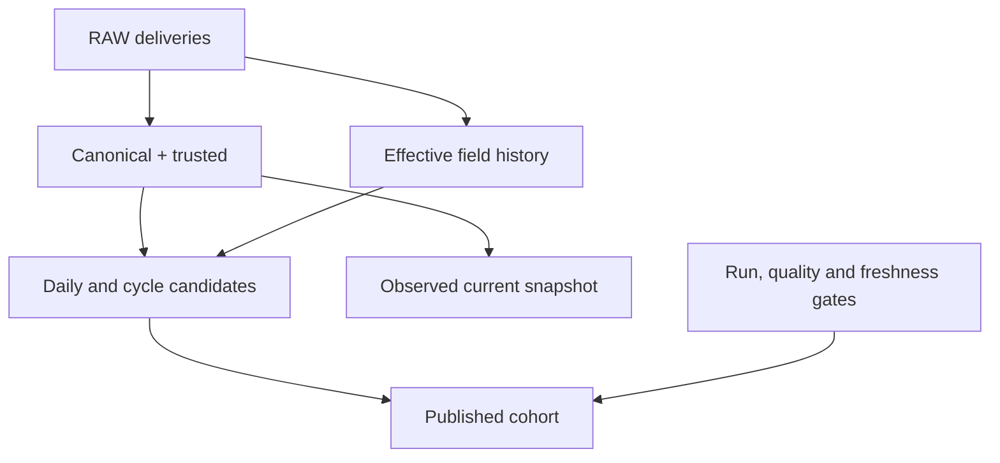

# FINAL_AUDIT

## Resumen ejecutivo

**NOT READY para primer commit ni para anunciar la implementación como validada públicamente en GitHub, bajo los gates definidos por el propietario.** El working tree corregido está entregado para revisión. El único bloqueo de aceptación residual es B01: falta ejecutar PostgreSQL 16.15 real con Docker/PowerShell y sesiones independientes. No es evidencia de un fallo nativo observado; es evidencia que falta y que no se reemplaza por un emulador.

La revisión final trató las correcciones como no confiables: volvió a comprobar winners, history, NULL/zero, procedencia, metadata y recovery; endureció pruebas que aceptaban errores inespecíficos, corrigió inspección sin dotenv y cerró la ventana entre validación/copia mediante una transacción REPEATABLE READ más reconciliación del contenido publicado. La comparación manifest/catálogo también descubrió N06: post-hook parse-time contaba canonical en vez de RAW. Se corrigió con hooks diferidos y boundary pre-DML; el cierre F10 usa assertions de conteos físicos, no sólo progreso. Ningún cambio se publicó/commiteó.

| Clasificación residual | Cantidad | Interpretación |
|---|---:|---|
| P0 — Critical | 0 | No se identificaron secretos reales ni defectos críticos residuales |
| P1 — High | 1 | B01: aceptación nativa obligatoria pendiente |
| P2 — Medium | 0 | No se dejó abierto un defecto material confirmado dentro del alcance funcional comprobado |
| P3 — Low | 0 | Cierre de packaging aplicado; licencia permanece decisión explícita, no defecto técnico |
| INFO | 6 | Límites/seguimientos explícitos descritos abajo; no capacidades certificadas |

Los cuatro cierres parciales F11/F14/F16/F18 son facetas de B01, no cuatro vulnerabilidades nativas demostradas. Los otros veinte CLOSED se refieren al componente/semántica reproducida en PostgreSQL 18/PGlite y verificaciones de archivos; **no certifican soporte ejecutado de PostgreSQL 16 o Windows**. La matriz detallada y limitaciones individuales están también en REMEDIATION_REPORT.md.

## Fuente y alcance real

Fuente actual: ZIP79 archivos,181364 bytes, SHA-256 `d11013333639bd5100a961bef1831fc697a188e66724f255b154a1b60c506636`. Todos los hashes de su extracción autoritativa permanecieron iguales. El informe original sirvió para F01–F24; no se auditó un GitHub inexistente ni rutas de la computadora del usuario.

Se inspeccionaron recursivamente Python, SQL, modelos/macros/tests/snapshot/YAML dbt, DDL/migración, Compose/PowerShell, requirements/packaging, archivos de higiene y toda la documentación. Se compararon 63 columnas RAW con tipos/nullability entre DDL, source YAML, contrato y readiness. Los modelos del DAG final se contrastaron con manifest/artifacts y catálogo de salida. No se afirma inspección de secretos/artefactos locales que deliberadamente quedaron fuera del ZIP.

Runtime probado: Linux, Python 3.12.14; dbt-core 1.12.5, dbt-postgres 1.11.0, psycopg 3.3.6. Pruebas SQL sobre PGlite 0.5.8/PostgreSQL 18.3 mediante servicio auxiliar de auditoría, no dependencia del proyecto. PGlite comparte backend y omite autenticación real: no prueba ACLs/roles por login, aislamiento de conexiones ni contención/MVCC nativos.

## Arquitectura reconstruida del estado final

| Capa | Implementación/grain | Evaluación |
|---|---|---|
| raw | 5 tablas físicas, identity raw_record_id; sin uniqueness business ni FKs; revisiones append | Boundary durable en datos y permisos previstos de ingest; autenticación efectiva pendiente |
| analytics staging | 2 canonical incrementals delete+insert y vistas trusted; field/effective states, masters current, 2 quarantines físicas | Canonical inválido separado de valid trusted; mismos macros de normalización/rechazo |
| analytics intermediate | 8 vistas: historia, enriquecimiento, activity/weather/conditions, prácticas, ciclos, assignment harvest | Grains explícitos antes de joins; historie RAW separada del snapshot |
| analytics marts | 5 tablas full-rebuild | Candidate; no promesa de aislamiento durante build ni costo bounded downstream |
| snapshots | snap_fields, check/current fields, observation transaction timestamptz | Historia observada de current, no business history ni as-known bitemporal completo |
| published | 5 tablas estables con PKs; DML/copy verification/marker en una TX | Interfaz accepted; OIDs/objetos/dependencias read-view preservados funcionalmente |
| ops | runs, checkpoints, scans, releases, migrations + guards | Progreso por modelo distinto de validación global/release/event completeness |

23 modelos =10 staging +8 intermediate +5 marts;1 snapshot;258 data tests;1 hook de proyecto. Un build completo exitoso suma283 recursos. No hay model implementado desaparecido de la lista esperada: todos los stg/int/dim/fct originales existen; se añaden winners, weather quarantine, field-state winners y harvest assignment. Los cinco marts consumer se publican sólo por el coordinator.

## B01 — Aceptación nativa obligatoria pendiente

- **Severity:** P1 — High, por criterio de aceptación, no por afirmar un bug de PostgreSQL 16.
- **Archivos/líneas:** docker-compose.yml:3; scripts/bootstrap.ps1:25; agridax/acceptance.py:125,413; agridax/admin.py:13; agridax/database.py:46; agridax/publication.py:78.
- **Hallazgo:** no se ejecutó el camino objetivo desde un volumen Docker vacío, ni PowerShell bootstrap/rerun, ni sesiones autenticadas independientes con ACL/contención/lectura consistente.
- **Evidencia:** `python -m agridax.acceptance --docker` se intentó y terminó con RuntimeError por Docker ausente. No hay docker/podman/pwsh/powershell disponibles. El binario PostgreSQL 16.14 auxiliar no pudo inicializar un cluster: initdb rechazó ejecución root, y el entorno no permitió cambiar a un usuario válido. No se inició una instancia nativa ni se eludió esa limitación.
- **Por qué importa:** roles/grants correctos en fuente y éxito SQL18 no demuestran autenticación16, Compose health, PowerShell exit codes, comportamiento de locks concurrentes o lectores reales.
- **Riesgo concreto:** diferencias de runtime/plataforma/privilegios pueden impedir first boot o el protocolo single-writer. Certificarlas ahora produciría una afirmación no sostenida.
- **Corrección/criterio de cierre:** ejecutar `python -m agridax.acceptance --docker` en un entorno con la imagen objetivo y PowerShell; conservar acceptance_results y artefactos/run IDs, sin NOT RUN/FAIL; ejecutar clean bootstrap y rerun del volumen aislado, permisos negativos, segundo writer, timeout de ingesta y lector repeatable-read. El runner ya codifica estas operaciones y sólo destruye su proyecto/volumen con nombre único.
- **¿Bloquea primer commit?:** Sí bajo los gates solicitados. No significa que guardar este working tree en Git sea peligroso: significa que no corresponde declararlo baseline aceptado.
- **¿Bloquea GitHub?:** Sí para publicación con estas garantías/aceptación. El código puede revisarse como implementación aún pendiente; en esta tarea no hubo publicación.

## Matriz final F01–F24

| ID | Estado | Verificación decisiva |
|---|---|---|
| F01 | CLOSED | inspection_debug_from_dotenv_outside_root; dbt debug de cada release; instalación editable desde copia limpia |
| F02 | CLOSED | stale_event_full_identity; stale_weather_full_identity; backfill_preserves_winner; raw_rebuild_canonical_equivalence; raw_rebuild_weather_canonical_equivalence |
| F03 | CLOSED | valid_to_invalid_event; invalid_winner_retained; valid_to_invalid_weather; invalid_to_valid_event; weather_recovery_retains_physical_quarantine |
| F04 | CLOSED | same_update_current_correction; temporal_half_open_boundary; corrected_historical_context; raw_rebuild_historical_fact_equivalence; event_before_first_state_blocks_release |
| F05 | CLOSED | first_run_backfill_rejected; compile_bounds_missing_start/end; compile_bounds_full_refresh; backfill_preserves_winner; empty_targets_recover_without_checkpoint_reset |
| F06 | CLOSED | event_quarantine_*; invalid_event_not_in_fact_*; weather_quarantine_*; weather_recovery_retains_physical_quarantine |
| F07 | CLOSED | zero_vs_missing_weather; weather_zero_and_null_measurement; business_date_uses_utc_boundary; event_quarantine_* negativo |
| F08 | CLOSED | snapshot_observation_is_aware; ingestion_only_retry_does_not_version_snapshot; idempotent_snapshot; rebuild histórico independiente |
| F09 | CLOSED | 4 tests Python de bounds con subcasos; 10 compile_bounds_*; first_run_backfill_rejected |
| F10 | CLOSED | processing_full_scan_counts_physical_deliveries; processing_normal_lower_uses_previous_checkpoint; processing_backfill_counts_raw_losing_revision; processing_empty_target_preserves_full_scan_evidence; non_winner_advances_processing; backfill_does_not_rewind_or_advance_checkpoint; future_ingestion_metadata_blocks_release |
| F11 | PARTIALLY CLOSED | unmanaged_dbt_mutation_refused; stale_validation_without_live_writer_refused; checks funcionales de locks/procedencia; pruebas nativas codificadas |
| F12 | CLOSED | publication_rollback_after_copy2; rollback_all_five_marts_data_oid; successful_promotion_preserves_objects; published_metadata_preserved; reader_select_grant; consumer_trigger_changed_copy_rejected |
| F13 | CLOSED | candidate_tamper_rejected; tamper_preserves_release; standalone_publisher_refused; stale_validation_without_live_writer_refused; consumer_trigger_failure_preserves_release; test_lock_cleanup_preserves_commit_uncertainty |
| F14 | PARTIALLY CLOSED | authenticated_tcp_complete_raw_contract; incompatible_raw_readiness_rejected; baseline/rerun funcional; --docker ejecutado: fallo por Docker ausente |
| F15 | CLOSED | test_quoted_values_and_process_precedence; test_empty_process_value_does_not_fall_back; test_ports; inspection_debug_from_dotenv_outside_root |
| F16 | PARTIALLY CLOSED | 258 data tests por build final; 9 unit tests; batería funcional final; valor 420000/120.50 y duración2h comprobados por literales independientes |
| F17 | CLOSED | Comparación literal automatizada 63 columnas/tipos/nullability DDL↔YAML↔contracts↔readiness; columnas documentadas contrastadas con catálogo; comandos inspect y enlaces/fences |
| F18 | PARTIALLY CLOSED | Revisión completa SQL/config; reader_select_grant de catálogo; tests dotenv/placeholder; pruebas de login/permisos negativas codificadas |
| F19 | CLOSED | freshness_override_error; freshness_does_not_mutate_raw; freshness_failure_preserves_release; zero_vs_missing_weather; empty_source_freshness_blocks_release |
| F20 | CLOSED | raw_rebuild_canonical_equivalence; raw_rebuild_weather_canonical_equivalence; raw_rebuild_historical_fact_equivalence; empty_targets_recover_without_checkpoint_reset; empty_weather_target_recovery |
| F21 | CLOSED | first_harvest_metrics; first_harvest_not_total_production; harvest_reconciliation_statuses; superseded_and_open_cycles; simultaneous_plantings_specific_test_failed; historical_area_* |
| F22 | CLOSED | agridax.preflight en proyecto y copia limpia; test_secret_detection_does_not_print_values; inspección/allowlist del ZIP; original79 hashes intactos |
| F23 | CLOSED | repository_correction_then_old_retry; repository_late_arrival; repository_invalid_observable; repository_fixture_reruns_no_duplicate_batches; todos los checks posteriores |
| F24 | CLOSED | pip install literal y fresh-copy -c lock; pip check; unit/preflight; ZIP allowlisted; .user.yml/.gitkeep redundantes removidos |

Comandos/results completos, counts y exclusiones están en VALIDATION_EVIDENCE.md. Un test intencionalmente fallido puede tener su assertion de aceptación PASS: el runner verifica el error específico y que no cambió la release. Eso no convierte el build adverso fallido en build exitoso.

## Dictámenes técnicos

**Reproducibilidad:** instalación literal de requirements y nueva copia sin .env/target/logs ni profile de usuario aprobadas en Linux 3.12, incluyendo constraints, pip check, unit tests y preflight. Recursos dbt/infra se ubican desde paquete editable instalado, no sys.path ad hoc. Config helper genera la única configuración privada requerida. Recorrido funcional desde schemas/datos aislados y smoke adicional de copia/venv/storage SQL18 nuevos con publicación+rerun aprobados; Docker-volume/PowerShell/PG 16 sigue NO VERIFICADO. No se ocultó un INSERT manual requerido por la plataforma: todos los escenarios están codificados como fixtures.

**Seguridad:** no se identificó secreto real en source/ZIP entregable. .env y variantes privadas ignoradas; placeholders inoperables; loopback; roles/ownership/ACL previstos separados. Initializer no acepta workload roles elevados y revoca PUBLIC/privilegios sobrantes. Credenciales admin sólo se usan para initialize/migrations; el archivo local contiene todas las identidades y no aísla secretos de otros procesos del mismo usuario OS. Autenticación/least privilege efectivos no certificados por el motor auxiliar.

**dbt/DAG:** dos incrementals con unique_key compuesto/delete+insert/on_schema_change=fail; trusted/intermediate son vistas y marts full tables. Required full-graph build y manifest/results frescos bloquean selector/defer/empty-mode/artefactos antiguos como prueba de promoción. Los checks estructurales conservan redundancias útiles por layer. RAW not_null/PK/unique son parcialmente redundantes con DDL; permiten detectar cambios del contrato, no sustituyen integración.

**SQL/modeling:** dedup total para un input fijo; normalización compartida; joins con grain previo y half-open histórico; FULL OUTER por field/date con uniqueness; cantidades/unidades filtradas; measured0/NULL/fuente ausente preservados. Daily usa explícitamente UTC y no calendario. Contexto histórico usa fields efectivo; dimensiones current no son usadas para inferir cultivo/área de evento. Prácticas sólo representan status reportado current, sin as-of por fecha.

**Temporal:** same-update correction, frontera exacta/microsegundo previo, futuro current excluido, evento previo al primer estado bloqueado, área histórica0/NaN bloqueada y RAW reconstruction independientes de snapshot comprobados. LEAD presupone persistencia hasta siguiente estado; no prueba gaps/valid_to explícitos ni bitemporalidad. Snapshot observado pierde información si se borra y no se fabrica tiempo de observación desde RAW.

**Incremental/backfill:** changed-key/all-version, prioridad dated-first, invalidation/recovery, late business dates/new arrivals, old retry después de avance global y reconstrucción global coherentes. Checkpoint independiente avanza aun si deliveries pierden la dedup; scopes/scans persisten; backfill no modifica normal progress. Horizon y locks coordinan timestamp/commits cooperativos; no se usa identity como commit frontier. Bounds se validan/normalizan cronológicamente antes de SQL. Target vacío recupera todas las keys.

**Data quality/quarantine:** physical quarantine y logical invalid winner son distintos; corrección posterior no borra evidencia. Finite guards cierran el defecto NaN del input. Las relaciones históricas/fan-out/positive intervals y expected current completan pruebas débiles originales. Reconciliation comparte parte de lógica con modelos: puede repetir un bug de normalización; fixtures con identidad/contexto/error/valores independientes reducen ese riesgo. No se prometen alertas, completeness por productor ni cobertura de todas las combinaciones posibles.

**Publicación:** identidad/run/evidencia/fingerprints más TX REPEATABLE READ; cinco replacements y marker atómicos; contenido copiado verificado; rollback de fallo2, tamper candidate, trigger de copia y conservación de OIDs/index/check/comment/view/grant comprobados en motor funcional. DDL de primera creación es transaccional; reruns evitan DROP/RENAME. Dependencias FK arbitrarias y schema changes se resuelven por migración explícita/fallo, nunca CASCADE. Lectores multi-query requieren su propio RR cohort; comprobación nativa pendiente. COMMIT con ACK perdido es unknown y se reconcilia por ops.releases, sin prometer rollback.

**Recovery/operación:** ledger persiste ventana/progreso por canonical incluso si un test downstream falla; accepted release se conserva. Full DAG recovery evita descendants ausentes tras selector parcial. Migrations con checksum distinguen init de evolución de volumen; changing applied SQL se rechaza. Recovery bounded de keys puede ejecutar lecturas/rebuilds/checksums globales; no es promesa de costo bounded. No hay scheduler/alertas/backups productivos desplegados ni benchmarks.

**Documentación/higiene:** DDL/YAML/contratos, rainfall_mm, IDs/grains/clocks, weather-only vars y paths ADR reconciliados. README interno ya no es starter; scaffold vacío deliberado. Constraints son resolución Linux 3.12 comprobada, no hashes de wheels ni validación Windows. No LICENSE inventada. El ZIP excluye archivos privados y runtime, además de `.user.yml` generado; conserva todos los source/config/fixtures/tests necesarios.

## A. Bloqueos antes del primer commit

Sólo B01 residual: ejecución nativa completa de Docker PG 16 + PowerShell y sesiones independientes. F11/F14/F16/F18 no deben cerrarse por haber agregado código. No se identificó un P0/P1 de lógica confirmado pendiente después de las correcciones funcionales. El dictamen global permanece NOT READY hasta satisfacer este gate; no se pide al usuario editar manualmente código ya corregido.

## B. Bloqueos/recomendaciones antes de GitHub

Cerrar B01 y preservar descripción exacta de local executable/target GCP. Ejecutar el preflight sobre el contenido staged cuando exista un índice que el propietario decida crear; esta tarea no lo creó. Elegir licencia si se pretende autorizar reutilización, sin adjudicar derechos inventados. Ningún Git remote/commit/push/PR ocurrió.

## C. INFO — mejoras que pueden esperar

1. **I01 — Revision/source contracts:** all-undated retry y clocks de proveedores no comparables no permiten inferir orden business. Weather combina providers por field/time bajo ese acuerdo. Fuente/state identity necesaria para tombstones o corrección de effective boundary. Archivos: normalized_raw, winner SQL, ADR0002. No bloquea bajo el contrato reducido documentado.
2. **I02 — Metric/domain scope:** first closing harvest/whole-field area, profundidad de riego sumada sin ponderación, weather rainfall como suma de medidas reportadas y prácticas current no equivalen a producción total, cobertura horaria, riego aplicado total o practices históricas. Intervalos aditivos/cumulativos de rain deben acordarse al integrar productores reales; no se certifica ese origen externo. Archivos: daily/cycle SQL, ADR0004.
3. **I03 — Compute/cost:** RAW reconciliation, MD5/string_agg y mart copies completos tienen costo/memoria/WAL/index maintenance no acotados por bounds. No se midió un límite de escala. Planificar affected-date/key recomputation, controles de bytes/jobs y benchmark cuando volumen/SLO lo justifique. Archivos: winner tests, publication, recovery.
4. **I04 — Observabilidad:** arrival aggregate y counts persisted no miden productores detenidos individualmente, event-time completeness, coverage por campo ni alertas. Runs interrumpidos pueden requerir reconciliar status/locks/marker. Archivos: pipeline, ops DDL, sources YAML.
5. **I05 — Fallos extremos:** no se probó pérdida real de ACK durante COMMIT, restore de backup, crash de host ni bloqueo externo por FK/schema evolution. El contrato reporta unknown/explicit failure; no inventa recuperación total probada. Archivos: publication/database/admin y recovery.
6. **I06 — Distribución:** imagen sin digest ejecutado, constraints sin wheel hashes ni validación Windows y licencia sin decisión. No obliga a añadir complejidad; completar estas evidencias/decisiones al estabilizar distribución. Archivos: Compose/pyproject/requirements/runtime policy.

## D. Architecture/GCP follow-up

La ausencia de GCP no se penaliza como feature fallida. Trasladar preservación física RAW, revisiones comparables, invalid winner/trusted/quarantine, effective vs observed history, backfill keys y cohorts validados. BigQuery necesita decisiones nuevas para advisory locks/ingestion frontier, DML de promoción o tablas versionadas y snapshots/costos.

No trasladar literalmente JSONB, casts PostgreSQL, FILTER/bool_or, LATERAL, EPOCH, identity/indexes ni NOT MATERIALIZED. Revisar serialización del surrogate hash de ciclos: JSONB PostgreSQL y JSON BigQuery pueden dar bytes distintos. Snapshot fields debe conservar TIMESTAMP observado, separado de DATETIME de negocio si se introduce. Correcciones que mueven field/date deben recalcular grupos anteriores y nuevos.

ADRs0001–0005 ya fijan decisiones locales/target; antes de cloud se necesitan acuerdos de source revisions/provider grain, commit/replay frontier, cohort promotion, lluvia aditiva vs acumulada, crop/area/practices y controles de bytes/particiones/retención. GCS/Cloud Run/Scheduler/Secret Manager/IAM/Monitoring sólo cuando exista una necesidad de replay, ejecución, scheduling, secretos o operación real. Pub/Sub no se justifica únicamente por un umbral de15 min; no se añade aquí.

## Scoring independiente (0–10)

| Área | Nota | Motivo |
|---|---:|---|
| dbt design | 7.5 | DAG/materializaciones/grains y reconciliación claros; mutaciones administradas y contratos schema todavía no enforced en todos los marts |
| SQL/data modeling | 7.5 | Join temporal/NULL/grain correctos en casos probados; métricas deliberadamente limitadas y reglas de fuente externas |
| incremental/idempotency | 8.0 | Global winner e invalidación/retry/backfill/rebuild defendibles; requiere metadata/protocolo cooperativos |
| temporal modeling | 8.0 | Effective RAW vs observed separado, fronteras/correcciones/rebuild; no bitemporal/full source state identity |
| data quality/testing | 7.5 | 258 SQL tests, assertions adversas y error específico; native/concurrency y oráculos independientes incompletos |
| recovery/backfill | 7.5 | Bounds/ledger/descendants/full/empty recovery; costo global y backup/restore no validados |
| quarantine | 8.0 | Rechazo compartido y physical/logical semantics comprobados; no DLQ/gestión operacional externa |
| safe publication | 7.0 | TX/cohort/provenance/metadata/post-copy checks sólidos; lectores/concurrencia/ACK nativos pendientes |
| Python quality | 7.0 | Config/package/SQL param/transactions/test runner; coordinator/aceptación extensos requieren disciplina de mantenimiento |
| Docker/local reproducibility | 5.0 | Instalación/copia/config probadas; clean Docker+PowerShell objetivo sin evidencia ejecutada |
| documentation | 8.5 | Contratos y límites concretos; native pendientes visibles y GCP target honesto |
| repository hygiene | 8.0 | Config segura/ignore/preflight/paquete; scan heurístico y falta índice real por autorización |
| operational maturity | 6.0 | Ledger/gates/timeouts/reconcile implementados; operación nativa, restore/alerting/escala sin prueba |
| architecture clarity | 8.0 | Candidata/publicada, history y trade-offs bien separados; futura adaptación cloud todavía requiere decisiones |
| overall seniority signal | 7.0 | Corrección/recovery y límites razonados aportan señal Senior; no justifica certificación Staff/operación sólo por añadir componentes |

## Once respuestas finales

1. **¿Primer commit listo?** No bajo los gates: B01 pendiente. Working tree corregido y revisable entregado.
2. **¿GitHub listo?** No para publicarlo como validado. No se publicó nada.
3. **¿Qué bloquea primer commit?** PG 16/Docker/PowerShell clean/rerun y auth/locks/MVCC nativos, agrupados en B01.
4. **¿Qué bloquea GitHub?** El mismo gate y cualquier afirmación de validación nativa que exceda evidencia; no hay secreto identificado que requiera rotación.
5. **¿Tres cambios con mayor impacto?** Global canonical/invalid transitions; historia business-effective RAW reconstruible; release coordinada con evidencia/objetos estables. Los tres están aplicados y probados funcionalmente; completar B01 es el siguiente mayor paso.
6. **¿Mejor seniority?** Correcciones no inflan counts, progreso distinto de release, half-open/history explícita, recovery sin snapshots business, quarantine física y rollback/procedencia/metadata.
7. **¿Menos maduro?** Evidencia operativa objetivo, performance/restore/observabilidad por fuente, acuerdos domain/source y mantenibilidad del runner/coordinator.
8. **¿Claims README/docs no sostenidos?** Se corrigieron los encontrados; no se encontró claim restante de GCP/producción/escala/SLA o bootstrap nativo ejecutado. Roles son implementación fuente con verificación nativa pendiente, no seguridad certificada.
9. **¿Qué cuestionaría seriamente Senior/Staff?** Declarar single-writer/least privilege completos sin pruebas nativas; asumir revision clocks comparables o backfill costo bounded sin contrato. La entrega hace esos límites explícitos.
10. **¿Archivos que no deben entrar?** .env/variantes, venv, target/logs/packages, caches/egg-info/IDE/volume data y .user.yml generado; excluidos del paquete. .gitkeep en directorios poblados removidos.
11. **¿Archivo imprescindible faltante?** No se identificó source/config necesario ausente en el paquete. Se añadieron profile/config/package/control migrations/runner/fixtures/contracts. Falta evidencia nativa, no un archivo secreto oculto. LICENSE queda elección explícita del propietario.
